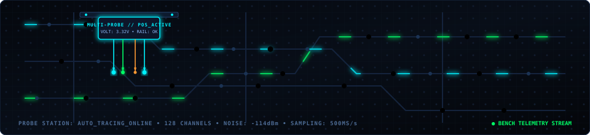

# Hizam Nahari
### Certified Hardware Technician (BNSP) & Linux Systems Automation Practitioner

  
  

  
  
  
  
  
  

---

## Greetings from the Workbench

Hello! I am **Hizam Nahari**, a laptop and mobile hardware technician based in Sidoarjo, East Java, Indonesia.

My daily work unfolds across the repair bench: handling soldering irons, hot-air rework stations, digital multimeters, injecting DC voltage to isolate overheated micro-components, reading boardview schematics, and replacing damaged surface-mount ICs on laptop motherboards and mobile phones.

Alongside physical board-level repairs, I administer bare-metal Linux workstations in our shop, engineer automation pipelines, and build **zero-bloat software systems**.

In my view, tracking down a short circuit on a 19V VIN power rail shares the exact same essence as isolating a defect in a Linux terminal: both demand meticulous schematic analysis, addressing the root cause rather than applying temporary patches, and the rewarding moment of seeing a system power on and run rock-solid.

---

### The Story Behind `@4ntiDandruff`

The handle **`@4ntiDandruff`** originated from real-world repair bench servicing:

* **System "Dandruff"**: To me, "dandruff" describes the clutter of vendor bloatware, pre-installed promotional software, runaway telemetry, and stealth background tasks that cause customer laptop fans to whine at maximum speed during basic word processing.
* **Classic Terminal Aesthetics (4)**: Replacing the letter 'A' with '4' follows traditional leetspeak conventions, keeping the command string compact and swift to type in terminal sessions.
* **Zero-Bloat Mission**: This handle serves as an enduring reminder to engineer software that strips away superfluous bloat, delivering calm, lightweight, and responsive systems.

  

---

## Real Workbench Projects & Shop Utilities

Every line of code on this profile was created to solve operational challenges directly at the repair bench and workshop:

### [Megabox Releases](https://github.com/4ntiDandruff/megabox-releases)
**Multi-Platform Desktop Workspace for Hardware Technicians (Windows & Linux)**
* **Field Challenge**: Technicians often juggle dozens of disconnected utility windows (terminals, web docs, flash tools, resistor decoders), cluttering screens and exhausting system RAM.
* **Technical Solution**: Unified standalone workspace built with Tauri v2 (Rust) consolidating workbench tools into a single desktop interface with under 40MB RAM usage.
* **Practical Benefit (*Which Means...*)**: *The technician's digital workbench stays organized, tool switching is instantaneous, and low-spec workstations remain responsive without Electron overhead.*  
`Tauri v2` • `Rust` • `Desktop Native` • `Windows & Linux`

### [Zero-Bloat Skills Ecosystem](https://skill.megapass.web.id)
**39 Circuit-Level SOP Modules for Bare-Metal Linux & Multi-Agent AI Gateways**
* **Field Challenge**: Coordinating shop servers, BIOS programmers, CCTV streams, and AI orchestrators on energy-frugal workshop hardware (Core i3-3240) without memory exhaustion.
* **Technical Solution**: 39 field-tested technician SOP modules interfaced directly with AI orchestrators (Google Antigravity, Claude Code, OMP, OpenCode, Codex). Built on a zero build-step architecture without runtime node_modules, maintaining RAM usage under 50MB.
* **Practical Benefit (*Which Means...*)**: *Daily workshop automation runs silently in the background without hogging CPU cycles or spinning up fans.*  
`Linux Bare-Metal` • `AI Agent Skills` • `Zero-Bloat Architecture` • `Python/Bash`

### [CH341A BIOS Flasher Tauri](https://github.com/4ntiDandruff/CH341A-BIOS-Flasher-Tauri)
**Streamlined Desktop GUI for USB EEPROM Programmers**
* **Field Challenge**: Typing lengthy flashrom command chains in the terminal invites syntax mistakes during time-critical motherboard repairs.
* **Technical Solution**: Desktop GUI built with Tauri v2 (Rust) that wraps flashrom commands into intuitive, disciplined action controls (chip detection, dump backup, 3-pass verification, and flashing).
* **Practical Benefit (*Which Means...*)**: *Firmware verification and writing finish quickly with minimal misclicks before the chip is soldered back to the motherboard.*  
`Tauri v2` • `Rust` • `TypeScript` • `flashrom`

### [Mobile View Browser Extension](https://github.com/4ntiDandruff/mobile-view)
**Workbench Browser Extension for Instant Pixel-Accurate Mobile Previews**
* **Field Challenge**: Standard browser developer responsive modes (F12) feel rigid and fail to accurately reflect single-handed smartphone thumb interaction.
* **Technical Solution**: Pure Chromium Manifest V3 extension built without bundler overhead, featuring accurate mobile viewports and automatic live reload via Linux kernel inotify events.
* **Practical Benefit (*Which Means...*)**: *Inspect mobile layouts directly from desktop displays without repeatedly handling physical test phones.*  
`JavaScript` • `Chromium Manifest V3` • `Tailwind CSS` • `HTML5`

### [ADB Mobile Debloater](https://github.com/4ntiDandruff/adb-uninstaller)
**Android App Management & Debloater GUI via USB ADB**
* **Field Challenge**: Customer phones (Samsung, Xiaomi, Oppo, Vivo) run low on internal storage and RAM due to factory bloatware that cannot be uninstalled via standard menus.
* **Technical Solution**: Desktop utility built with Tauri v2 interfacing with Android Debug Bridge (ADB), leveraging curated safety filters (package whitelist/blacklist) without requiring root privileges.
* **Practical Benefit (*Which Means...*)**: *Restores free storage and RAM on customer devices without risking bootloops or system crashes.*  
`Tauri v2` • `React` • `Android Debug Bridge (ADB)`

### [Windows Optimizer Toolkit](https://github.com/4ntiDandruff/windows-optimizer)
**Lightweight System Cleanup Scripts for Customer PCs**
* **Field Challenge**: Customer laptops arriving at the workbench often choke on temporary clutter, leftover cache, and multiple unneeded startup processes.
* **Technical Solution**: Native PowerShell and Batch scripts that purge temporary directories and disable hidden background startup items safely without risky registry changes.
* **Practical Benefit (*Which Means...*)**: *System tune-ups complete in seconds without relying on questionable third-party cleaner tools laden with advertisements.*  
`PowerShell` • `Batch` • `Windows Utilities`

### [Auto-Extract Downloads for Linux](https://github.com/4ntiDandruff/auto-extract-downloads)
**Event-Driven Archive Extraction via Linux Kernel Inotify**
* **Field Challenge**: Manually extracting downloaded schematic archives, boardview files, or firmware dumps interrupts bench focus.
* **Technical Solution**: POSIX Shell daemon backed by inotify-tools that watches download folders at 0% idle CPU, automatically extracting archives the moment downloads finish.
* **Practical Benefit (*Which Means...*)**: *Schematics and firmware files unpack immediately into clean directories, keeping hands on the keyboard.*  
`POSIX Shell` • `inotify-tools` • `Systemd User Unit`

### [Reverse SSH Tunnel](https://github.com/4ntiDandruff/reverse-ssh-tunnel)
**Automated Reverse SSH Tunnel with Self-Healing Watchdog**
* **Field Challenge**: Workshop hardware or remote field nodes located behind strict NAT or dynamic IPs are difficult to access without public port forwarding.
* **Technical Solution**: OpenSSH-based reverse tunneling script featuring periodic reconnect loops and a self-healing watchdog to ensure remote terminal channels remain unbroken.
* **Practical Benefit (*Which Means...*)**: *Remote access to the repair bench and shop servers remains stable without costly static public IP subscriptions.*  
`OpenSSH` • `Bash` • `Watchdog Daemon`

---

## Technical Foundation & Daily Workbench Stack

Every tool is selected based on real workbench utility: stable, transparent, and resilient in the field.

| Domain | Tool | Practical Value at the Workbench |
|---|---|---|
| **Operating System** | Linux (Ubuntu / Debian / Kubuntu) | *Primary workstation OS. Rock-solid stability, transparent logs, and complete system control without unwanted background tasks.* |
| **Scripting** | Bash / Shell & Python | *Primary tools for daily shop automation, fast data processing, and glue logic between system services.* |
| **Backend & Web** | Python FastAPI & SQLite | *Straightforward code flow, readable error logs, and SQLite WAL durability that withstands abrupt shop power cuts without heavy database servers.* |
| **Web Frontend** | HTML5, Tailwind CSS, Alpine.js | *Responsive interfaces without complicated build tools (zero build-step), edited directly and rendered instantly in browsers.* |
| **Desktop App** | Tauri v2 (Rust) | *Lean alternative to Electron. Produces lightweight, fast native desktop binaries consuming under 40MB RAM.* |
| **Version Control** | Git & GitHub | *Disciplined change logs, workshop infrastructure version control, and open documentation.* |

---

## Personal Philosophy Behind the Name MEGAPASS

The electronics servicing workshop I established in Sidoarjo is named **Megapass Intra Solusindo**. The name carries a meaningful personal foundation:

* **Mega**: My beloved wife's name — the constant inspiration behind my dedication, integrity, and daily responsibility.
* **PASS**: The most satisfying sight on a technician's bench. The bold green **PASS** indicator on diagnostic instruments is the official verification that a defective device has been restored, power rails are stable, all hardware functions are normal, and it is ready to be returned to its owner.

This standard shapes everything I build: whether soldering a microscopic component or writing software logic, every task is carried out with thorough care until it genuinely earns a **PASS**.

---

## Hardware Training & Official Certifications

My technical competence is grounded in formal education and certification across hardware electronics and computing:

* **BNSP (National Professional Certification Agency)** - Certified Electronics & Mobile Device Hardware Technician
* **BMY Yogyakarta** - Specialization in Laptop Power Rail Schematics & Motherboard Diagnostics
* **ITS Surabaya (PRODISTIK)** - D1 Information Technology & Circuit Design Fundamentals
* **PTC Indonesia & Arsalabs** - Advanced Mobile Device Hardware Repair
* **Magistra Utama** - Computer Hardware & Network Engineering Program

Physical certificate documentation and technician portfolios are available at: **[megapass.web.id/teknisi](https://megapass.web.id/teknisi/)**

---

  
  
  

**Megapass Intra Solusindo • Sidoarjo, Indonesia**  
*Certified Hardware Technician (BNSP) & Linux Systems Automation Practitioner*

