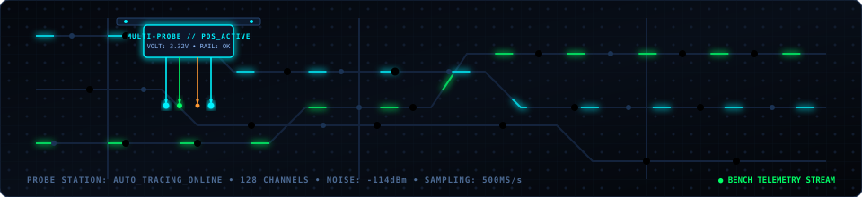

# Hizam Nahari
### Teknisi Perangkat Keras (BNSP) & Praktisi Otomasi Sistem Linux

  
  

  
  
  
  
  
  

---

## Salam dari Meja Servis

Halo! Saya **Hizam Nahari**, teknisi perangkat keras laptop dan ponsel asal Sidoarjo, Jawa Timur.

Keseharian saya berputar di atas meja servis: memegang solder, blower uap panas, multitester, menyuntikkan tegangan DC untuk meraba komponen yang panas terbakar, membaca skema jalur boardview, dan mengangkat chip IC mikro yang rusak di motherboard laptop maupun ponsel.

Di sela-sela urusan fisik ini, saya mengelola jaringan Linux bare-metal di ruko, meracik otomasi meja kerja, dan membangun **sistem software mandiri berprinsip zero-bloat**.

Bagi saya, melacak short-circuit di jalur 19V VIN laptop punya esensi yang persis sama seperti menelusuri bug di terminal Linux: keduanya menuntut pembacaan skema yang presisi, bedah akar masalah tanpa jalan pintas tambal sulam, dan kepuasan melihat mesin kembali hidup normal dengan stabil.

---

### Makna di Balik Identitas `@4ntiDandruff`

Nama **`@4ntiDandruff`** lahir dari pengalaman nyata saat membersihkan komputer dan ponsel milik pelanggan ruko:

* **Ketombe di Perangkat**: Bagi saya, "ketombe" adalah tumpukan bloatware, aplikasi sampah bawaan pabrik, telemetri rakus, dan puluhan proses siluman di latar belakang yang bikin kipas laptop pelanggan meraung panas padahal cuma dipakai mengetik dokumen.
* **Gaya Klasik Terminal (4)**: Huruf 'A' diganti angka '4' mengikuti kebiasaan lawas leetspeak, ringkas dan nyaman diketik langsung saat membuka sesi terminal.
* **Misi Zero-Bloat**: Nama ini menjadi pengingat harian untuk selalu merancang perkakas yang membuang proses mubazir, menghasilkan sistem yang hening, enteng, dan responsif.

  

---

## Perkakas Nyata dari Meja Servis

Setiap baris kode di akun ini bukan proyek main-main atau sekadar latihan sintaks. Seluruh repositori lahir langsung dari kebutuhan nyata di meja kerja dan operasional ruko:

### [Megabox Releases](https://github.com/4ntiDandruff/megabox-releases)
**Aplikasi Desktop Ruang Kerja Teknisi Multi-Platform (Windows & Linux)**
* **Masalah Lapangan**: Teknisi sering membuka puluhan jendela utilitas terpisah (terminal, web, tool flash, kalkulator resistor) yang membuat desktop berantakan dan boros RAM.
* **Solusi Teknis**: Aplikasi ruang kerja mandiri berbasis Tauri v2 (Rust) yang menyatukan seluruh perkakas meja servis dalam satu antarmuka desktop ultra-ringan dengan konsumsi RAM di bawah 40MB.
* **Dampak Nyata (*Yang artinya...*)**: *Meja kerja digital teknisi selalu teratur, cepat berpindah alat, dan komputer kerja tetap gesit tanpa beban Electron.*  
`Tauri v2` • `Rust` • `Desktop Native` • `Windows & Linux`

### [Ekosistem Zero-Bloat Skills](https://skill.megapass.web.id)
**39 Modul SOP Meja Servis, Linux Bare-Metal, dan Multi-Agent AI Gateway**
* **Masalah Lapangan**: Mengelola server ruko, flash BIOS, streaming CCTV, dan orkestrasi asisten AI di PC tua hemat daya (Core i3-3240) tanpa kehabisan memori.
* **Solusi Teknis**: Kumpulan 39 modul SOP sirkuit teruji lapangan yang terhubung langsung ke berbagai orkestrator AI (Google Antigravity, Claude Code, OMP, OpenCode, Codex). Mengusung arsitektur zero build-step tanpa node_modules di runtime, menjaga alokasi RAM tetap di bawah 50MB.
* **Dampak Nyata (*Yang artinya...*)**: *Otomasi ruko harian berjalan senyap di latar belakang tanpa membuat komputer lemot atau kipas meraung.*  
`Linux Bare-Metal` • `AI Agent Skills` • `Zero-Bloat Architecture` • `Python/Bash`

### [CH341A BIOS Flasher Tauri](https://github.com/4ntiDandruff/CH341A-BIOS-Flasher-Tauri)
**Antarmuka Desktop Ringkas untuk Alat Flash EEPROM USB**
* **Masalah Lapangan**: Mengetik parameter panjang utilitas flashrom di terminal rawan salah ketik saat teknisi dikejar waktu menangani chip BIOS laptop pelanggan.
* **Solusi Teknis**: Antarmuka visual berbasis Tauri v2 (Rust) yang membungkus perintah flashrom menjadi tombol kendali yang terukur (identifikasi tipe IC, dump backup, verifikasi 3-pass, dan flash firmware).
* **Dampak Nyata (*Yang artinya...*)**: *Proses pembacaan dan pengisian BIOS fisik tuntas lebih cepat serta minim salah klik sebelum chip disolder kembali ke motherboard.*  
`Tauri v2` • `Rust` • `TypeScript` • `flashrom`

### [Mobile View Browser Extension](https://github.com/4ntiDandruff/mobile-view)
**Ekstensi Browser Workbench untuk Pratinjau Tampilan Mobile Sekali Klik**
* **Masalah Lapangan**: Mode responsive bawaan browser (F12) kaku dan tidak memberi gambaran nyata jangkauan jempol satu tangan pada layar smartphone.
* **Solusi Teknis**: Ekstensi Chromium Manifest V3 murni tanpa bundler rumit, dilengkapi bingkai smartphone presisi dan reload otomatis via event inotify kernel Linux.
* **Dampak Nyata (*Yang artinya...*)**: *Pengujian tata letak web di layar ponsel bisa dilakukan langsung dari monitor desktop tanpa perlu bolak-balik mengambil HP fisik.*  
`JavaScript` • `Chromium Manifest V3` • `Tailwind CSS` • `HTML5`

### [ADB Mobile Debloater](https://github.com/4ntiDandruff/adb-uninstaller)
**Antarmuka Manajemen & Pembersih Aplikasi Android via USB ADB**
* **Masalah Lapangan**: Memori ponsel pelanggan (Samsung, Xiaomi, Oppo, Vivo) sering sesak oleh aplikasi pabrik yang tidak bisa dicopot lewat setelan biasa.
* **Solusi Teknis**: Utilitas desktop berbasis Tauri v2 via Android Debug Bridge (ADB) dengan katalog filter aman (whitelist/blacklist paket) tanpa mewajibkan akses root.
* **Dampak Nyata (*Yang artinya...*)**: *Kapasitas penyimpanan dan RAM ponsel pelanggan kembali lega tanpa resiko sistem crash atau bootloop.*  
`Tauri v2` • `React` • `Android Debug Bridge (ADB)`

### [Windows Optimizer Toolkit](https://github.com/4ntiDandruff/windows-optimizer)
**Kumpulan Skrip Pembersih Sistem Ringan untuk PC Pelanggan**
* **Masalah Lapangan**: Komputer pelanggan yang masuk meja kerja sering tercekik tumpukan file sampah, sisa cache, dan belasan startup siluman.
* **Solusi Teknis**: Skrip native PowerShell dan Batch murni untuk membersihkan direktori sementara dan mematikan startup siluman dengan aman tanpa utak-atik registry berbahaya.
* **Dampak Nyata (*Yang artinya...*)**: *Servis pembersihan sistem tuntas dalam hitungan detik tanpa perlu memasang aplikasi cleaner pihak ketiga yang rawan membawa iklan.*  
`PowerShell` • `Batch` • `Windows Utilities`

### [Auto-Extract Downloads for Linux](https://github.com/4ntiDandruff/auto-extract-downloads)
**Ekstraksi Arsip Otomatis Berbasis Event Kernel Linux**
* **Masalah Lapangan**: Membuka arsip zip/rar skema boardview atau file firmware secara manual memutus konsentrasi kerja servis.
* **Solusi Teknis**: Daemon POSIX Shell berbasis inotify-tools yang memantau folder unduhan dengan beban 0% CPU siaga, langsung mengekstrak berkas otomatis begitu unduhan rampung.
* **Dampak Nyata (*Yang artinya...*)**: *Berkas skema atau file BIOS langsung siap dipakai di folder tujuan, tangan teknisi tidak perlu lepas dari keyboard.*  
`POSIX Shell` • `inotify-tools` • `Systemd User Unit`

### [Reverse SSH Tunnel](https://github.com/4ntiDandruff/reverse-ssh-tunnel)
**Terowongan SSH Otomatis dengan Sekring Pemulihan Mandiri**
* **Masalah Lapangan**: Mesin ruko atau perangkat remote yang berada di balik NAT ketat atau IP dinamis sulit diakses dari luar tanpa port forwarding publik.
* **Solusi Teknis**: Skrip reverse SSH tunnel berbasis OpenSSH dengan loop reconnect berkala dan watchdog self-healing yang menjaga jalur kendali terminal tetap tembus dan stabil.
* **Dampak Nyata (*Yang artinya...*)**: *Akses remote ke meja kerja dan server ruko selalu terjaga tanpa perlu berlangganan IP publik statis yang mahal.*  
`OpenSSH` • `Bash` • `Watchdog Daemon`

---

## Fondasi Teknologi & Alat Kerja Harian

Setiap teknologi yang saya pilih wajib lolos uji kepraktisan di meja kerja: stabil, transparan, dan tahan banting.

| Bidang | Alat | Nilai Nyata di Meja Kerja |
|---|---|---|
| **Sistem Operasi** | Linux (Ubuntu / Debian / Kubuntu) | *Sistem kerja utama. Stabil, transparan, hemat sumber daya, dan memberi kendali penuh tanpa proses latar belakang tersembunyi.* |
| **Bahasa Skrip** | Bash / Shell & Python | *Senjata utama otomasi harian, pengolah data cepat, dan perekat integrasi antar-layanan sistem.* |
| **Backend & Web** | Python FastAPI & SQLite | *Alur kode lugas, mudah dirawat, dan database SQLite WAL sangat tangguh terhadap insiden mati lampu mendadak tanpa server DB berat.* |
| **Tampilan Web** | HTML5, Tailwind CSS, Alpine.js | *Antarmuka responsif tanpa proses build rumit (zero build-step), langsung disunting di file dan dirender instan oleh browser.* |
| **Desktop App** | Tauri v2 (Rust) | *Pengganti Electron yang ringan. Menghasilkan biner aplikasi desktop native yang kecil, cepat, dan hemat RAM di bawah 40MB.* |
| **Version Control** | Git & GitHub | *Pencatatan riwayat perubahan terukur, kontrol versi konfigurasi ruko, dan dokumentasi repositori terbuka.* |

---

## Makna Personal di Balik Nama MEGAPASS

Unit usaha servis yang saya rintis di Sidoarjo bernama **Megapass Intra Solusindo**. Nama ini membawa filosofi mendalam:

* **Mega**: Nama panggilan istri tercinta, sumber motivasi, ketekunan, dan rasa tanggung jawab dalam setiap langkah usaha.
* **PASS**: Kata paling melegakan bagi seorang teknisi. Kotak hijau bertuliskan **PASS** pada layar instrumen pengujian adalah bukti sah bahwa perangkat yang rusak sudah sembuh total, seluruh jalur tegangan aman, fungsi perangkat keras normal, dan siap diserahkan kembali kepada pemiliknya.

Prinsip ini menjadi standar di meja kerja saya: baik saat menyolder kaki komponen mikro berukuran milimeter maupun menulis baris logika software, semuanya digarap seteliti mungkin sampai layak dinyatakan **PASS**.

---

## Sertifikasi Resmi & Pelatihan Hardware Fisik

Kompetensi teknis saya ditopang oleh pendidikan dan sertifikasi resmi di bidang elektronika perangkat keras dan komputer:

* **BNSP (Badan Nasional Sertifikasi Profesi)** - Teknisi Elektronika & Perangkat Keras Ponsel Tersertifikasi Resmi
* **BMY Yogyakarta** - Spesialisasi Analisa Skematik Jalur Tegangan & Motherboard Laptop
* **ITS Surabaya (PRODISTIK)** - D1 Teknologi Informasi & Dasar Perancangan Sirkuit
* **PTC Indonesia & Arsalabs** - Reparasi Perangkat Keras Ponsel Tingkat Lanjut
* **Magistra Utama** - Program Keahlian Teknisi Komputer & Jaringan

Dokumentasi sertifikat fisik dan portofolio teknisi dapat diakses di: **[megapass.web.id/teknisi](https://megapass.web.id/teknisi/)**

---

  
  
  

**Megapass Intra Solusindo • Sidoarjo, Indonesia**  
*Teknisi Perangkat Keras (BNSP) & Praktisi Otomasi Sistem Linux*

